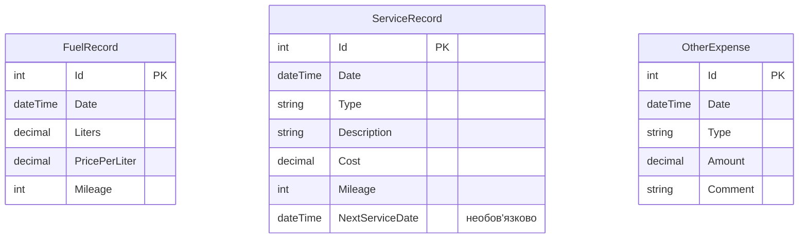

# Модель даних (Data Model)

## ER-діаграма

Примітка: загальна сума заправки (`TotalCost = Liters × PricePerLiter`) не зберігається в базі, а обчислюється в коді. Таблиці між собою не повʼязані: кожна зберігає окремий вид витрат.